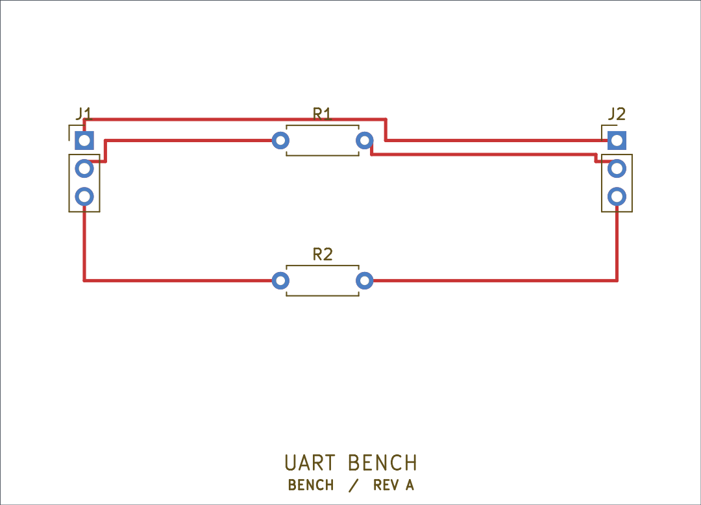

# 🏥 Smart Infusion Pump
### STM32F407 + FreeRTOS | Medical Grade | IEC 62304 Aligned

> Developed during Embedded R&D Internship at **Walnut Medical, Mohali**

---

## 📋 Project Overview
A safety-critical smart infusion pump featuring closed-loop PID flow 
control, real-time RTOS scheduling, Peltier temperature regulation, 
and WiFi monitoring — built on STM32F407VGT6 with FreeRTOS.

---

## 🔧 Hardware Architecture

| Component | Part | Function |
|-----------|------|----------|
| Main MCU | STM32F407VGT6 | FreeRTOS controller |
| Safety MCU | ATmega328P | Independent watchdog |
| WiFi | ESP32-WROOM-32UE | Remote monitoring |
| Motor Driver | DRV8825 | NEMA17 stepper |
| Pressure | MPRLS0015PG | Flow sensing |
| Temperature | DS18B20 x2 | Peltier control |
| Bubble Detect | BSTH-003 | Safety detection |
| Battery | BQ24650 + MAX17043 | Power management |
| Display | SSD1306 OLED | User interface |

---

## 🧵 FreeRTOS Task Structure

| Task | Priority | Stack |
|------|----------|-------|
| vMotorControlTask | AboveNormal | 512 |
| vSafetyMonitorTask | Realtime | 256 |
| vTemperatureTask | Normal | 256 |
| vDisplayTask | BelowNormal | 512 |
| vCommunicationTask | BelowNormal | 512 |
| vPressureTask | Normal | 256 |

---

## 📌 STM32F407 Pin Assignments

| Signal | Pin | Function |
|--------|-----|----------|
| USART1_TX/RX | PA9/PA10 | ESP32 WiFi |
| USART3_TX/RX | PD8/PD9 | ATmega Safety |
| I2C1_SCL/SDA | PB6/PB7 | OLED + EEPROM |
| I2C2_SCL/SDA | PB10/PB11 | Pressure + Fuel |
| TIM2_CH1 | PA0 | Peltier PWM |
| STEP_PUL/DIR/EN | PD11/PD12/PD13 | DRV8825 |
| TEMP_OW | PC9 | DS18B20 |
| RELAY_CTRL | PB15 | Motor Relay |
| BUZZ_SIG | PE1 | Buzzer |
| FAN_CTRL | PC8 | Cooling Fan |

---

## ⚙️ Clock Configuration
- HSE Crystal: 8MHz
- PLL: M=8, N=336, P=2
- SYSCLK: **168MHz**
- APB1: 42MHz | APB2: 84MHz

---

## 📐 PCB Specifications
- **Board Size:** 120mm x 100mm
- **Layers:** 2-layer with GND pour
- **Components:** 186
- **DRC Violations:** 0
- **Status:** Gerbers submitted to manufacturer

---

## 🛡️ Safety Features
- ATmega328P independent safety watchdog
- TPS3823 hardware watchdog timer
- Overcurrent protection
- Bubble detection alarm
- Limit switch monitoring
- Fault detection FSM
- EEPROM non-volatile parameter storage

---

[Browse the firmware by processor](docs/firmware-map.md)

## 📁 Repository Structure

```
smart-infusion-pump/
├── Core/                       STM32 application, headers and startup
├── Drivers/                    CMSIS and STM32 HAL
├── Middlewares/                FreeRTOS and middleware
├── SMART_INFUSION.ioc          STM32CubeMX configuration
├── SMART_INFUSION_ATmega/      ATmega companion sketch
├── SMART_INFUSION_ESP32/       ESP32 companion sketch
└── docs/firmware-map.md        Source index by processor
```

---

## 👤 Author
**Zaidan Khan** — Embedded R&D Intern @ Walnut Medical  
📧 khanzaidaan786@gmail.com  
🔗 [LinkedIn](https://linkedin.com/in/zaidan-khan-ab30922aa)

## Reference hardware files

[Telemetry observation fixture](hardware/README.md) is a newly drawn bench interface for this project. The hardware guide includes the pinout, KiCad and Altium projects, schematic PDF, routed PCB image, BOM, fabrication artwork and validation reports.


