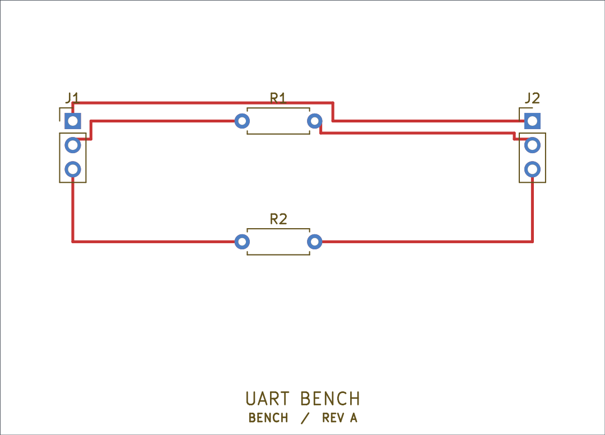

# Telemetry observation fixture

Revision A · Reference hardware for Smart Infusion Pump

A passive two-channel observation card for replaying STM32 telemetry on the bench. One channel corresponds to USART1_TX (PA9) and the other to USART3_TX (PD8) in the checked-in CubeMX file.

This circuit was drawn for the portfolio from the interface description. Its connector numbering, board outline and part placements belong to this revision. Original product CAD, connector pinouts and measured results were unavailable. Physical bring-up is pending.

The top view overlays front copper in red, back copper in blue and silkscreen in brown. The board measures 63.50 × 45.72 mm. It uses two copper layers, plated through-hole components and 0.30 mm traces.

## Design files

| File | Use |
| --- | --- |
| [KiCad project](kicad/reference.kicad_pro) | Open in KiCad 9 with the included symbol table and symbol library. |
| [Altium project](altium/reference.PrjPcb) | Open the project with the adjacent native [schematic](altium/reference.SchDoc) and [PCB](altium/reference.PcbDoc). Components and land patterns are embedded in the placed documents. |
| [Schematic PDF](images/schematic.pdf) | Zoom or print the circuit, pin numbers and signal labels. |
| [PCB top view](images/copper.svg) | Inspect both routed copper layers and the assembly markings. |
| [Bill of materials](bom.csv) | Select parts to match the footprint and population notes. |
| [Gerber and drill ZIP](gerbers-and-drill.zip) | Review the manufacturing artwork for this reference revision. |

## Interface and wiring

Connect a development board or signal generator only. The card has no path back to an MCU RX pin, motor drive, fluid circuit or patient connection. Both analyzer channels are 3.3 V logic inputs.

Read the pin numbers from the component side. On each header the square pad marks pin 1. Use the table when wiring an external module.

| Header | Connector | Pin | Signal |
| --- | --- | ---: | --- |
| J1 | BENCH SRC | 1 | `GND` |
| J1 | BENCH SRC | 2 | `PA9_TX1` |
| J1 | BENCH SRC | 3 | `PD8_TX3` |
| J2 | ANALYZER | 1 | `GND` |
| J2 | ANALYZER | 2 | `MON_TX1` |
| J2 | ANALYZER | 3 | `MON_TX3` |

## Assembly and bench checks

Fit the headers and components according to the BOM. Confirm LED polarity where fitted. Check the board for shorts before attaching external equipment.

1. Confirm each source-to-monitor path measures approximately 1 kilohm and both channels are isolated from each other.
2. Replay two independent UART streams from a bench generator. Capture each output separately and confirm that interrupting the analyzer has no effect on the generator.

## Firmware connection

The original STM32 pin configuration identifies PA9 and PD8 as transmit outputs. Use a development board or a synthetic UART source to test capture. [Pinned CubeMX configuration](https://github.com/khanzaidan/smart-infusion-pump/blob/533e038e8589ce8a454668a1a26a9ea66db71109/SMART_INFUSION.ioc)

## Validation

KiCad 9.0.2 reported zero electrical-rule violations, zero PCB design-rule violations, zero unconnected pads and zero schematic-to-board parity errors. The exported schematic netlist matched the specified 10 pin assignments on 5 named nets. [Electrical report](validation/erc.rpt) · [PCB report](validation/drc.rpt)

The Altium files were read back with AltiumSharp. Connectivity reconstructed from the schematic geometry matched the net on each PCB pad. KiCad independently imported the Altium PCB and verified component designators, pad net names, pad widths and drill sizes, trace and via counts, and board dimensions. Altium Designer desktop opening, compilation, manufacturing review and physical measurements are pending.

## Sources

Project background follows the supplied résumé. KiCad Community through-hole land patterns are distributed under CC BY-SA 4.0 with the KiCad design exception. The layout image is a CAD plot of this board. [KiCad library license](https://www.kicad.org/libraries/license/) · [AltiumSharp file writer](https://github.com/issus/AltiumSharp/tree/5caeff2fc0b15c9b63f226ba3f872c65f7f39486)
